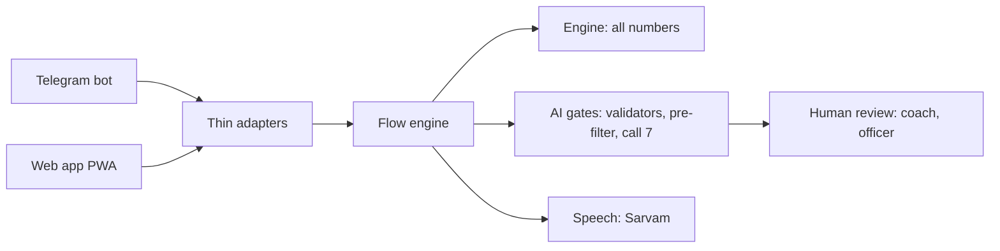

# Cohort Coach

<!-- TODO-HUMAN(Gopi): add CI badge once the GitHub remote exists -->


Groups primary teachers for training by the specific error their pupils make, not by geography. A termly 10-item check shows what Grade 3 children get wrong; teachers whose classes share an error get a 3-week voice track on that one error, and rehearse it privately in a Practice Class with simulated children before trying it on real ones.

**What is and is not known.** Rehearsing with simulated children is a hypothesis, not a result: no source we have tested it, and the pilot in Seema's partner schools is what tests it. We will report the verdict whatever it is. Whether children improve is shown only by the next check, never by lessons delivered or sessions held.

Team A-Z 0-9 · Hack2skill × Anthropic "AI for Foundational Learning" · Challenge 3 (Teacher Support & Training).

## For judges: try it

The demo is a judge-mode web app (no login, simulated data, every screen labelled "Simulated").

**Live demo (one link for both modes): https://cohort-coach-pwa-1097171252131.asia-south1.run.app** The landing page shows the mode (Judge demo, or Pilot for staff with a sign-in) and the role. Judge demo runs on simulated data with no sign-in. The Telegram bot link is still to come (webhook not set).

<!-- TODO-HUMAN(Gopi): add the bot link once the Telegram webhook is set -->

1. Open the web app. The landing page has four role cards (Teacher, Mentor, Coach, Programme officer) and a guided tour. Follow [docs/judge-test-script.md](docs/judge-test-script.md) (about 5 minutes).
2. In Telegram, send `/start judge` to the bot to run the same teacher flow there.
3. Open the Practice Class and turn on the "AI layers" overlay to see each call, its guardrails and its checker verdict on a live turn.

## What is built, cut, and still pending

Statuses are the same as in [AI_USAGE.md](AI_USAGE.md) and [docs/build/PROGRESS.md](docs/build/PROGRESS.md). Nothing marked cut or pending is claimed anywhere else.

| Area | State |
| --- | --- |
| Engine: errors, item generator, diagnosis, grouping, statistics, simulator | Built, tested; numbers in [docs/evidence/numbers.md](docs/evidence/numbers.md) |
| Practice Class (text and voice) with five simulated children | Built; text turn median latency is over target (4968 ms against 3000 ms), reported in [evals/results.md](evals/results.md) |
| Check by sheet photo, call 8 reading | Built; the hand-keyed accuracy eval is pending Shivani's keying |
| Content pipeline: draft, checks, review queue, two keys | Built; live SUB-SFL drafts in hi and en ([docs/content-pipeline.md](docs/content-pipeline.md)) |
| Teacher flows on Telegram and the web app (check, cards, lessons with voice, my result) | Built; not yet run on three real phones |
| Cohort thread, mentor item approvals, officer error map and funnel | Built in reduced form ([docs/cohort-space.md](docs/cohort-space.md)) |
| **Pilot mode** (sheet upload and lesson audio on Google Cloud) | Built and deployed ([docs/build/reports/PILOT-MODE.md](docs/build/reports/PILOT-MODE.md)) |
| Red team | 52 cases, 0 unsafe reach a teacher ([evals/results.md](evals/results.md)) |
| Cut, logged in [docs/build/PARKING.md](docs/build/PARKING.md) | Calls 4, 6 and 9, the model run, Tamil lessons, the Telegram thread relay, mentor recording, the visit brief, the content library |
| Not measured | A real low-end phone and Slow 3G; user-testing rounds 3 and 4; human-rated evals |

Roadmap: [docs/roadmap.md](docs/roadmap.md). Submission pack: [docs/submission/](docs/submission/).

## Where AI is used

Every AI capability claim, with its file path and a status (Specified, Built or Verified), is in [AI_USAGE.md](AI_USAGE.md). The live proof is `python scripts/ai_proof.py`, which writes `docs/evidence/ai_usage_proof.json`.

<!-- AI-USED:START (generated by `python tasks.py readme` from ai/registry.py; do not hand-edit) -->
Eight Claude calls, each loaded from a versioned prompt in `ai/prompts/` and run through one path (`ai/client.py`): structured output, prompt caching, bounded retries, a deterministic fallback and one audit row. Everything below is read from `ai/registry.py`.

| # | Call | Model | When |
| --- | --- | --- | --- |
| 1 | Child voices | `claude-sonnet-5-5` | live turn |
| 2 | Teacher-move labeller | `claude-haiku-5-5` | live turn |
| 3 | Rehearsal feedback | `claude-sonnet-5-5` | session end |
| 4 | Mentor method capture | `claude-sonnet-5-5` | after recording |
| 5 | Track drafting | `claude-opus-5-5` | offline, Message Batches API |
| 6 | Reflection digest | `claude-haiku-5-5` | weekly |
| 7 | Output checker | `claude-haiku-5-5` | everything headed to a teacher |
| 8 | Answer reading | `claude-haiku-5-5` | per sheet photo |
| 10 | Demo teacher (judge mode only) | `claude-haiku-5-5` | live Watch run in judge mode |
| 11 | Sprite item author (offline) | `claude-sonnet-5-5` | offline authoring |

**Call 1: Child voices.** Say one short line as a simulated Grade 3 child in the Practice Class.

- *input*: Child persona, language, the teacher's labelled move, and the exact wrong answer the engine chose.
- *processing*: Claude writes one line of at most 30 words around the engine's number.
- *guardrails*: Every number must equal the engine's answer; length, language and script checks; pre-filter; one retry, then a template line.
- *evaluation*: 200 scripted turns: numbers match 100%; realism rated 1 to 5 by humans (pending until rated).
- *output*: A short spoken line in the child's voice, with an AI-layers overlay in judge mode.

**Call 2: Teacher-move labeller.** Label what the teacher just did with one move from a fixed list.

- *input*: One line the teacher said or typed, wrapped as untrusted data, and the technique's fixed move list.
- *processing*: A small model returns one label and a confidence.
- *guardrails*: The label must be in the fixed list (JSON schema); low confidence becomes 'other', which changes nothing; off-task and injection lines become 'off_task'.
- *evaluation*: 150 human-labelled lines, agreement at least 85%.
- *output*: A move label that moves the simulation's child state; never shown as a score.

**Call 3: Rehearsal feedback.** After a rehearsal, give two strengths and one thing to try, each quoting her words.

- *input*: The rehearsal transcript (stays on her phone unless she shares it) and the rubric of moves.
- *processing*: Claude writes two strengths and one idea to try, each with a quote.
- *guardrails*: Each quote must appear word for word in the transcript; points only from the rubric; no scores; pre-filter and call 7.
- *evaluation*: 30 transcripts: quotes 100% valid; usefulness rated by teachers (pending until rated).
- *output*: A private feedback card with a Checked badge and a 'this is wrong' flag.

**Call 4: Mentor method capture.** Turn a mentor's spoken answers into a method card, citing her sentences.

- *input*: The mentor's transcribed answers, split into numbered sentences.
- *processing*: Claude turns them into steps, each citing the sentence ids it came from.
- *guardrails*: Every cited id must exist; only what she said; she approves, then a reviewer approves.
- *evaluation*: Mentor edit size and reviewer acceptance, reported when mentors exist.
- *output*: A method card that can feed the next cohort's track.

**Call 5: Track drafting.** Draft a 3-week track: six 5-minute lessons and one model-lesson script.

- *input*: The error, language, up to 3 approved method cards and the lesson plan structure.
- *processing*: The strongest model drafts offline in a batch at half price.
- *guardrails*: Arithmetic checked by code; class numbers are slots filled by code; reading level; call 7; then a reviewer and a mentor approve.
- *evaluation*: Share of drafts accepted with minor edits; arithmetic correctness (code-checked).
- *output*: A reviewed track published as audio, with Checked and Reviewed badges.

**Call 6: Reflection digest.** Group a week of teacher reflections into themes; code counts them.

- *input*: Short reflections with names and schools removed by code first.
- *processing*: A small model assigns each reflection to a theme.
- *guardrails*: Code strips names before the call; the model never states a count, code counts the themes.
- *evaluation*: Mentor usefulness rating (pending until mentors rate).
- *output*: A weekly digest for the mentor.

**Call 7: Output checker.** Check anything headed to a teacher against the rubric and return a structured verdict.

- *input*: Candidate text, audience, language, target error, and what code already checked.
- *processing*: A small model scores the rubric: tone, safety, stereotypes, language, fit, reading level, maths, statistics, injection.
- *guardrails*: Includes rejected-before examples from reviewers; unsure means fail; a fail goes to a human or a template.
- *evaluation*: Red-team set: 0 unsafe outputs reach a teacher.
- *output*: A pass or fail verdict with a reason for the team and a one-line reason for the user.

**Call 8: Answer reading.** Read the digits a child wrote on an answer-sheet photo, blind.

- *input*: One sheet photo (base64 JPEG). It carries no name or roll number. The model is never told the expected answers.
- *processing*: A small vision model transcribes digits; a stronger model retries doubtful reads.
- *guardrails*: Reads outside the correct and error answers, or below the confidence bar, go to the teacher; Devanagari digits normalised; the photo is deleted right after.
- *evaluation*: Hand-keyed set: at least 98% of auto-accepted reads correct, at most 15% sent to the teacher.
- *output*: Per-box digits for the engine to diagnose, on her phone.

**Call 10: Demo teacher (judge mode only).** Play the teacher in a Practice Class Watch run, in an experienced or a struggling style, so a visitor can compare.

- *input*: The scenario, the approved move list, the style, the transcript so far and the engine's state of the five simulated children.
- *processing*: A small model picks one approved move and writes a line of at most 25 words in the chosen style.
- *guardrails*: The move id must be on the approved list for the style; every number must come from the scenario's allowed set; no answer leak beyond the style; no check item; on any failure the move's template line is used. The server refuses the call outside a judge session.
- *evaluation*: 20 runs per style: approved ids 100%, numbers in the allowed set, and the experienced runs cover more rubric points than the struggling runs in at least 18 of 20 pairs (rubric coverage is internal to the eval, never shown to a teacher).
- *output*: A teacher line labelled 'AI playing the teacher (demo only)'; never shown to a real teacher, who hears the reviewed model run.

**Call 11: Sprite item author (offline).** Draft the JSON spec of one new sprite item (a counted object) for a topic pack, at authoring time only.

- *input*: A short brief for one object (for example 'a mango') and the ids of the items that exist.
- *processing*: Claude drafts one item as a list of whitelisted shapes with integer numbers and palette-slot colours, plus a short English alt text.
- *guardrails*: Schema; shape and attribute whitelist; integer numbers; palette slots only (no hex); size budget; no text; the item must render at counts 1 and 5 in every palette and as a PNG; pre-filter and no-check-item checks on the words; call 7 on the words; a rejected draft returns the failing rule to the author and is never shown; then a coach approves and a programme officer enables.
- *evaluation*: Pending a live run. Until then the gates are proven by tests: each rule has a failing case.
- *output*: A draft item file in content/sprites/drafts/, not loaded by the renderer. It reaches a teacher only inside an enabled pack version. No art is generated at run time.

Gates: code validators → rule-based pre-filter → output checker (call 7) → human approval (track content, method cards) → teacher flag. Badges: *Checked ✓* after the first two automatic gates, *Checked ✓ · Reviewed ✓* after a human approves too. Details: [docs/guardrails.md](docs/guardrails.md), [docs/architecture.md](docs/architecture.md). Live map: `GET /api/judge/ai-map`; audit trail: `GET /api/judge/audit`.
<!-- AI-USED:END -->

## Guardrails, offline and privacy in brief

- **Guardrails** ([docs/guardrails.md](docs/guardrails.md)): code computes every number; nothing AI-written reaches a teacher before code checks, a rule-based pre-filter and the output checker; lessons also need a coach and then an officer. Rejection reasons feed the checker.
- **Offline and low data** ([docs/offline.md](docs/offline.md)): only the Practice Class needs a live connection and it falls back to text; uploads and lessons queue offline. Data per track is computed in [docs/evidence/data_budget.json](docs/evidence/data_budget.json) (inside the 10 MB target with text practice, over it if every session is voice).
- **Privacy** ([docs/privacy.md](docs/privacy.md)): no child names, faces or voices; sheet photos are deleted after reading; teachers see counts, never percentages; officers see aggregates only.

## Setup

```text
python tasks.py setup    # install dependencies; installs a pre-commit hook running `check`
python tasks.py dev      # API on :8000 + PWA on :5173
python tasks.py test     # all tests (use this, not bare pytest)
python tasks.py check    # lint + types + tests + eval smoke
python tasks.py seed     # the simulated block
```

Copy `.env.example` to `.env`. Without keys the app runs on recorded fixtures. Pilot mode (`PILOT_MODE=1`) serves only sign-in, sheet upload and lesson audio; see [docs/deploy.md](docs/deploy.md).

## Architecture



Details: [docs/architecture.md](docs/architecture.md).

## Repo map

| Path | What |
| --- | --- |
| `engine/` | Pure Python: error functions, items, diagnosis, grouping, mentors, statistics, simulator |
| `ai/` | The Claude calls: registry, client, prompts, validators, guardrails |
| `services/api/` | FastAPI routes, flow engine, channels (Telegram), review queue, cohorts, officer views |
| `services/pilot/` | Pilot mode: sign-in, sheet upload, lesson audio |
| `services/speech/` | Sarvam speech client |
| `apps/pwa/` | React PWA: teacher, cohort, officer, review, pilot and judge screens |
| `content/` | Scenarios, rubrics, move lists, personas, tracks (data, owned by Seema) |
| `evals/` | Eval sets, runners, generated `results.md` |
| `docs/` | Build log, design, evidence, guardrails, privacy, offline, roadmap, submission |
