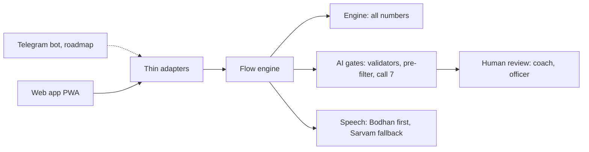

# Cohort Coach

<!-- TODO-HUMAN(Gopi): add CI badge once the GitHub remote exists -->


Groups primary teachers for training by the specific error their pupils make, not by geography. A termly 10-item check shows what Grade 3 children get wrong; teachers whose classes share an error get a 3-week voice track on that one error, and rehearse it privately in a Practice Class with simulated children before trying it on real ones.

**What is and is not known.** Rehearsing with simulated children is a hypothesis, not a result: no source we have tested it, and the pilot in Seema's partner schools is what tests it. We will report the verdict whatever it is. Whether children improve is shown only by the next check, never by lessons delivered or sessions held.

Team A-Z 0-9 · Hack2skill × Anthropic "AI for Foundational Learning" · Challenge 3 (Teacher Support & Training).

## For judges: try it

The demo is a judge-mode web app (no login, simulated data, every screen labelled "Simulated").

**Live demo (one link for both modes): https://cohort-coach-pwa-1097171252131.asia-south1.run.app** The landing page shows the role. The demo runs on simulated data with no sign-in. The demo is the web app only: Telegram is on the roadmap (the adapter is built in code but not deployed).

1. Open the web app. The landing page has four role cards (Teacher, Mentor, Coach, Programme officer) and a guided tour. Follow [docs/judge-test-script.md](docs/judge-test-script.md) (about 5 minutes).
2. Open the Practice Class and turn on the "AI layers" overlay to see each call, its guardrails and its checker verdict on a live turn.
3. **Demo flow (about 15 minutes):** on the Judge page, tap **Run the demo flow**, or open `#/demo?step=1`. No sign-in: the judge deployment is the credential. A bar on every screen says **Demo step n of 12** (step 13 is optional), with Back, Next, a link to the judge guide's question for that step, and **Reset demo** (clears this device's demo class and its server data only).

   1. Start as a teacher, in English, with a made-up class 3A (20 simulated children).
   2. Make the pre-test paper from the rules on Papers (or run `python scripts/seed_test_paper.py --class-id <id>` for the standard test paper); Enter check chooses it, adds the sheets by camera or by a folder of pictures (the team's Drive test folder, also in `demo/test-sheets/`), you approve each roll number, then Finish entering. It scores the answers with the paper's own key.
   3. Generate 20 filled demo sheets (`3A-roll01.png` ...), a ZIP and the demo answer file (`reads.json`).
   4. Sheet 1 is read by the AI (a real call, cached by the image's hash, at most 6 AI reads per demo); **Auto-fill the other sheets** loads the rest from the answer file with no AI call, and says so. Each roll number shows its status (Roll no N), with **Absent** and **Next not entered**.
   5. Review each sheet in the drawer (the sheet beside what was read, unsure boxes marked) and approve it.
   6. **Finish entering** (it asks first, and marks the roll numbers left as absent; the error finder runs on the phone; **Reopen the check** goes back), then **Simulate other classes' results** (24 simulated classes in 8 schools).
   7. Three cohorts from the real grouping code: her class is in 2 of them, one this term and one next term (one track a term).
   8. The first audio lesson: the AI drafts lesson 1, code fills the class's numbers, the server voice reads it, badge **Demo: pre-approved**.
   9. Practice Class with the lesson's next step.
   10. Cohort chat: a 60-second wait in the demo, **Skip the wait**; the AI answers only from approved material, and says it has none when there is none (today the strategies are drafts, so a person answers).
   11. The coach's queue (her question, a simulated mentor's method card, the AI draft of lesson 2) and the SCERT officer's dashboard (counts, any cell under 5 classes hidden).
   12. The post-test (optional): simulate it and see before and after.
   13. Optional: **Two classes to a cohort** (`#/two-classes`). Teachers T1 (3A) and T2 (3B) submit their checks. The first waits, and the second forms a cohort automatically, with the reason each class is in or out. The coach approves lesson 1 (call 5 drafts it; code writes it when no draft comes back), voiced in each teacher's language with her class's numbers. T1 answers Tried it, Partly or Not yet, and **Generate next lesson** makes her next one: code picks it, call 5 words it, and the coach approves it. T2 asks in the cohort chat with a made-up child's name (masked). The coach answers, and T1 sees the shared answer. A question typed offline is sent once she is back online. The coach's **Cohorts** step shows counts and a timeline. Two-class cohorts and counting a paper's only question of a kind are pilot and demo settings (labelled on screen). Report: [docs/build/reports/FLOW-CHECK.md](docs/build/reports/FLOW-CHECK.md).

   Everything made up says Demo, Simulated or Synthetic. Evidence: [docs/evidence/demo_synthetic_reading.md](docs/evidence/demo_synthetic_reading.md) (synthetic sheets only). Report: [docs/build/reports/DEMO-FLOW.md](docs/build/reports/DEMO-FLOW.md).

### The assistant

Every screen has an "Ask the assistant" button that opens `#/assistant`. Its scope is set on the server by the signed-in role (teacher, mentor, coach, officer, judge) and cannot be widened by a question. The judge session (the demo, no sign-in) also has **View as** (see the teacher, mentor, coach or officer assistant on simulated data), an **About this product** tab that answers from the repository, the rubric map ([docs/RUBRIC_MAP.md](docs/RUBRIC_MAP.md)), the deck and the video script with file, slide and video-time citations, and a ten-minute test path. It is read-only. Suggested answers are pre-written from the docs and work offline; typed questions use call 14 and abstain when nothing is found. A live-model run of call 14 is still pending ([evals/assistant_eval.md](evals/assistant_eval.md), [docs/build/reports/ASSISTANT.md](docs/build/reports/ASSISTANT.md)). Tests: `python -m pytest tests/assistant` and, from `apps/pwa`, `npx playwright test e2e/assistant.spec.ts`. Rebuild the index after docs change: `python scripts/build_assistant_index.py`. Before every deploy run `python tasks.py predeploy` (it rebuilds the index and checks that each role has suggested questions for each screen it reaches); the prompt that fills any gap is [docs/build/Claude Code prompt refresh the assistant reference before deploy.md](<docs/build/Claude Code prompt refresh the assistant reference before deploy.md>).

## What is built, cut, and still pending

Statuses are the same as in [AI_USAGE.md](AI_USAGE.md) and [docs/build/PROGRESS.md](docs/build/PROGRESS.md). Nothing marked cut or pending is claimed anywhere else.

| Area | State |
| --- | --- |
| Engine: errors, item generator, diagnosis, grouping, statistics, simulator | Built, tested; numbers in [docs/evidence/numbers.md](docs/evidence/numbers.md) |
| Practice Class (text and voice) with five simulated children | Built; text turn median latency is over target (4968 ms against 3000 ms), reported in [evals/results.md](evals/results.md) |
| Check by sheet photo, call 8 reading | Built; the hand-keyed accuracy eval is pending Shivani's keying |
| Content pipeline: draft, checks, review queue, two keys | Built; live SUB-SFL drafts in hi and en ([docs/content-pipeline.md](docs/content-pipeline.md)) |
| Teacher flows in the web app (check, cards, lessons with voice, my result) | Built; not yet run on three real phones |
| Telegram channel (the same flows as a bot) | Roadmap: the adapter and its golden-transcript tests are in the code, no bot is deployed and it is not part of the demo |
| Cohort thread, mentor item approvals, officer error map and funnel | Built in reduced form ([docs/cohort-space.md](docs/cohort-space.md)) |
| **The pilot in the same app** (import the real pre-test on Papers; Enter check chooses it and reads the sheets by camera or from a folder of pictures, which you approve one roll number at a time) | Built; checked with a stand-in class ([docs/build/reports/PAPER-FLOW-RESIDUES.md](docs/build/reports/PAPER-FLOW-RESIDUES.md)) |
| Red team | 52 cases, 0 unsafe reach a teacher ([evals/results.md](evals/results.md)) |
| Cut, logged in [docs/build/PARKING.md](docs/build/PARKING.md) | Calls 4, 6 and 9, the model run, Tamil lessons, the Telegram thread relay, mentor recording, the visit brief, the content library |
| Not measured | A real low-end phone and Slow 3G; user-testing rounds 3 and 4; human-rated evals |

Roadmap: [docs/roadmap.md](docs/roadmap.md). Submission pack: [docs/submission/](docs/submission/).

## Where AI is used

Every AI capability claim, with its file path and a status (Specified, Built or Verified), is in [AI_USAGE.md](AI_USAGE.md). The live proof is `python scripts/ai_proof.py`, which writes `docs/evidence/ai_usage_proof.json`.

<!-- AI-USED:START (generated by `python tasks.py readme` from ai/registry.py; do not hand-edit) -->
13 Claude calls are built, each loaded from a versioned prompt in `ai/prompts/` and run through one path (`ai/client.py`): structured output, prompt caching, bounded retries, a deterministic fallback and one audit row. 2 more are specified but not built yet (calls 4 and 6): they have a prompt and a schema, and no code calls them. Everything below is read from `ai/registry.py`.

| # | Call | Model | When |
| --- | --- | --- | --- |
| 1 | Child voices | `claude-sonnet-5-5` | live turn |
| 2 | Teacher-move labeller | `claude-haiku-5-5` | live turn |
| 3 | Rehearsal feedback | `claude-sonnet-5-5` | session end |
| 4 | Mentor method capture (planned, not built) | `claude-sonnet-5-5` | after recording |
| 5 | Track drafting | `claude-opus-5-5` | offline, Message Batches API |
| 6 | Reflection digest (planned, not built) | `claude-haiku-5-5` | weekly |
| 7 | Output checker | `claude-haiku-5-5` | everything headed to a teacher |
| 8 | Answer reading | `claude-haiku-5-5` | per sheet photo |
| 10 | Demo teacher (judge mode only) | `claude-haiku-5-5` | live Watch run in judge mode |
| 11 | Sprite item author (offline) | `claude-sonnet-5-5` | offline authoring |
| 12 | Chat question class | `claude-haiku-5-5` | when a teacher ticks AI help and sends a question |
| 13 | Chat reply draft | `claude-sonnet-5-5` | when a teacher ticks AI help and the question is about teaching |
| 14 | Assistant answer | `claude-haiku-5-5` | when a user types a free-text question to the assistant (suggested questions are pre-written) |
| 15 | Pilot sheet scan | `claude-haiku-5-5` | offline, in the pilot-ingest script on the demo machine (never in the hosted demo) |
| 16 | Paper reading | `claude-haiku-5-5` | when a teacher or coach uploads a PDF or photos on the Papers page (cached by file hash, cost-capped) |

**Call 1: Child voices.** Say one short line as a simulated Grade 3 child in the Practice Class.

- *input*: Child persona, language, the teacher's labelled move, and the exact wrong answer the engine chose.
- *processing*: Claude writes one line of at most 30 words around the engine's number.
- *guardrails*: Every number must equal the engine's answer; length, language and script checks; pre-filter; one retry, then a template line.
- *evaluation*: 200 scripted turns: numbers match 100%; realism rated 1 to 5 by humans (pending until rated).
- *output*: A short spoken line in the child's voice, with an AI-layers overlay in judge mode.

**Call 2: Teacher-move labeller.** Label what the teacher just did with one move from a fixed list.

- *input*: One line the teacher said or typed, wrapped as untrusted data, and the technique's fixed move list.
- *processing*: A small model returns one label and a confidence.
- *guardrails*: The label must be in the fixed list (JSON schema); low confidence becomes 'other', which changes nothing; off-task and injection lines become 'off_task'.
- *evaluation*: 150 human-labelled lines, agreement at least 85%.
- *output*: A move label that moves the simulation's child state; never shown as a score.

**Call 3: Rehearsal feedback.** After a rehearsal, give two strengths and one thing to try, each quoting her words.

- *input*: The rehearsal transcript (stays on her phone unless she shares it) and the rubric of moves.
- *processing*: Claude writes two strengths and one idea to try, each with a quote.
- *guardrails*: Each quote must appear word for word in the transcript; points only from the rubric; no scores; pre-filter and call 7.
- *evaluation*: 30 transcripts: quotes 100% valid; usefulness rated by teachers (pending until rated).
- *output*: A private feedback card with a Checked badge and a 'this is wrong' flag.

**Call 4: Mentor method capture.** Turn a mentor's spoken answers into a method card, citing her sentences. *Planned, not built: no code calls it yet.*

- *input*: The mentor's transcribed answers, split into numbered sentences.
- *processing*: Claude turns them into steps, each citing the sentence ids it came from.
- *guardrails*: Every cited id must exist; only what she said; she approves, then a reviewer approves.
- *evaluation*: Mentor edit size and reviewer acceptance, reported when mentors exist.
- *output*: A method card that can feed the next cohort's track.

**Call 5: Track drafting.** Draft a 3-week track: six 5-minute lessons and one model-lesson script.

- *input*: The error, language, up to 3 approved method cards and the lesson plan structure.
- *processing*: The strongest model drafts offline in a batch at half price.
- *guardrails*: Arithmetic checked by code; class numbers are slots filled by code; reading level; call 7; then a reviewer and a mentor approve.
- *evaluation*: Share of drafts accepted with minor edits; arithmetic correctness (code-checked).
- *output*: A reviewed track published as audio, with Checked and Reviewed badges.

**Call 6: Reflection digest.** Group a week of teacher reflections into themes; code counts them. *Planned, not built: no code calls it yet.*

- *input*: Short reflections with names and schools removed by code first.
- *processing*: A small model assigns each reflection to a theme.
- *guardrails*: Code strips names before the call; the model never states a count, code counts the themes.
- *evaluation*: Mentor usefulness rating (pending until mentors rate).
- *output*: A weekly digest for the mentor.

**Call 7: Output checker.** Check anything headed to a teacher against the rubric and return a structured verdict.

- *input*: Candidate text, audience, language, target error, and what code already checked.
- *processing*: A small model scores the rubric: tone, safety, stereotypes, language, fit, reading level, maths, statistics, injection.
- *guardrails*: Includes rejected-before examples from reviewers; unsure means fail; a fail goes to a human or a template.
- *evaluation*: Red-team set: 0 unsafe outputs reach a teacher.
- *output*: A pass or fail verdict with a reason for the team and a one-line reason for the user.

**Call 8: Answer reading.** Read the digits a child wrote on an answer-sheet photo, blind.

- *input*: One sheet photo (base64 JPEG). It carries no name or roll number. The model is never told the expected answers.
- *processing*: A small vision model transcribes digits; a stronger model retries doubtful reads.
- *guardrails*: Reads outside the correct and error answers, or below the confidence bar, go to the teacher; Devanagari digits normalised; the photo is deleted right after.
- *evaluation*: Hand-keyed set: at least 98% of auto-accepted reads correct, at most 15% sent to the teacher.
- *output*: Per-box digits for the engine to diagnose, on her phone.

**Call 10: Demo teacher (judge mode only).** Play the teacher in a Practice Class Watch run, in an experienced or a struggling style, so a visitor can compare.

- *input*: The scenario, the approved move list, the style, the transcript so far and the engine's state of the five simulated children.
- *processing*: A small model picks one approved move and writes a line of at most 25 words in the chosen style.
- *guardrails*: The move id must be on the approved list for the style; every number must come from the scenario's allowed set; no answer leak beyond the style; no check item; on any failure the move's template line is used. The server refuses the call outside a judge session.
- *evaluation*: 20 runs per style: approved ids 100%, numbers in the allowed set, and the experienced runs cover more rubric points than the struggling runs in at least 18 of 20 pairs (rubric coverage is internal to the eval, never shown to a teacher).
- *output*: A teacher line labelled 'AI playing the teacher (demo only)'; never shown to a real teacher, who hears the reviewed model run.

**Call 11: Sprite item author (offline).** Draft the JSON spec of one new sprite item (a counted object) for a topic pack, at authoring time only.

- *input*: A short brief for one object (for example 'a mango') and the ids of the items that exist.
- *processing*: Claude drafts one item as a list of whitelisted shapes with integer numbers and palette-slot colours, plus a short English alt text.
- *guardrails*: Schema; shape and attribute whitelist; integer numbers; palette slots only (no hex); size budget; no text; the item must render at counts 1 and 5 in every palette and as a PNG; pre-filter and no-check-item checks on the words; call 7 on the words; a rejected draft returns the failing rule to the author and is never shown; then a coach approves and a programme officer enables.
- *evaluation*: Pending a live run. Until then the gates are proven by tests: each rule has a failing case.
- *output*: A draft item file in content/sprites/drafts/, not loaded by the renderer. It reaches a teacher only inside an enabled pack version. No art is generated at run time.

**Call 12: Chat question class.** Decide what kind of question a teacher asked her mentor, so the right people see it first.

- *input*: The question with names, roll numbers and phone numbers already replaced, and its language.
- *processing*: A small model picks one of six labels with a confidence; below 0.6 the question counts as unclear.
- *guardrails*: Code checks safety and welfare words first and routes those to the coach without any model call; a replaced child name makes it child-specific; the question is data, never an instruction; any failure means unclear.
- *evaluation*: The 50-prompt chat red team (injection, child-specific, safety, off-topic, Tamil, Hindi and English mixing) must send nothing unsafe on its own.
- *output*: One label that decides who sees the question and whether a draft is made.

**Call 13: Chat reply draft.** Draft a short reply to a teacher's question from approved material only, for her mentor to send, change or replace.

- *input*: The masked question, the language, her cohort's error and the approved sentences retrieved for it (approved lessons and strategies).
- *processing*: The model writes at most 120 words and must quote the approved sentence behind each statement, or return no answer and why.
- *guardrails*: Every citation must name a retrieved source and quote it word for word; code checks sums, personal data, class numbers, pilot items and scores; call 7 checks tone and fit; it is a draft until a person sends it. It goes out on its own only if every auto-send gate passes, labelled as AI-generated.
- *evaluation*: Share of drafts sent as is, edited or discarded, and corrections after an automatic send, reported by code in docs/evidence/chat_metrics.json (simulated data in the demo).
- *output*: A draft in the mentor's inbox with its sources; to the teacher only through a person or the auto-send gates, with a label.

**Call 14: Assistant answer.** Answer one question for one role from the passages that role may read, with sources, or say there is no answer.

- *input*: The question (wrapped as data), the role, the language, and up to six passages retrieved from the role's own namespaces, with rubric rows for the judge.
- *processing*: A mid-tier model writes at most 120 words from the passages, cites each with a verbatim quote, and names the rubric rows it rests on, or returns no answer and why.
- *guardrails*: The scope comes from the server, never the prompt; retrieval cannot reach another role's namespace; code checks every quote word for word, the rubric rows, length, personal data, scores, claims of action and pressure words; the status labels, how to check and limits come from the rubric map, not the model; any failure falls back to an extract from the passages or to no answer.
- *evaluation*: evals/assistant_eval.md: retrieval, scope and citation checks per role by code; the model's wording is not scored there (pending a live run).
- *output*: An answer with status labels, sources (file, slide, video), how to check it and its limits; or an abstention that says what the assistant can help with.

**Call 15: Pilot sheet scan.** On a local machine only, read the class and roll number printed on a pilot sheet and say whether a person's name is written on it and where, so the region is blacked out before anything else sees the photo.

- *input*: One normalised pilot sheet photo (roll numbers only, no names), on the demo machine.
- *processing*: A small vision model returns the printed class code and roll number if it can see them, whether any person's name is written, and the rectangles to hide.
- *guardrails*: The script never guesses: an uncertain class or roll goes to the review list; code validates the shape and blacks the rectangles out of the normalised copy; only a yes or no and a count of regions are written to the report; a human reviews every sheet where a name was found.
- *evaluation*: The ingest report lists the counts (sheets scanned, names found, sheets for review). No accuracy claim is made for this call.
- *output*: A normalised copy with name regions blacked out, a class and roll for the file name, and a review list. Nothing reaches a teacher.

**Call 16: Paper reading.** Read the printed questions of a paper from a blank paper, an answer key or a child's answered sheet, so a teacher can bring in a paper she already used. Code computes every key.

- *input*: Up to three page images of one paper (rendered from a PDF, or photos). Only the printed questions matter; handwriting and any name are to be ignored and are not kept.
- *processing*: A small vision model lists each item with its operation and operands as printed, the prompt text, where its answer box is, a printed answer if a key is shown, and a flag when the page has handwriting.
- *guardrails*: The model is never asked for an answer key: code computes the correct answer, the competency and the error probes with the engine and re-checks them with independent arithmetic; a printed key that differs is flagged, never trusted; every item is confirmed by a person; the upload is deleted when the paper is confirmed or after 24 hours.
- *evaluation*: No accuracy claim yet. The importer's code-side checks are tested on recorded reads (tests/papers_hub); a live run on real papers is pending.
- *output*: A draft paper for a person to review item by item, with a coverage grid and open questions. Nothing is used until it is confirmed.

Gates: code validators → rule-based pre-filter → output checker (call 7) → human approval (track content, method cards) → teacher flag. Badges: *Checked ✓* after the first two automatic gates, *Checked ✓ · Reviewed ✓* after a human approves too. Details: [docs/guardrails.md](docs/guardrails.md), [docs/architecture.md](docs/architecture.md). Live map: `GET /api/judge/ai-map`; audit trail: `GET /api/judge/audit`.
<!-- AI-USED:END -->

## Papers page: create a paper two ways, assign it, and see what became of it

Open Papers (between Home and Enter check). **Create a paper** offers two routes. *Generate from rules* builds a paper by code from the approved rules (Paper Studio, below). *From a PDF or an answered sheet* brings in a paper you already used: a vision call (call 16, see "Where AI is used") reads only the printed questions; code computes every correct answer, error probe and coverage cell, flags a printed key that differs, and you confirm each item. Handwriting and names are ignored and the upload is deleted when you confirm or after 24 hours. Each paper on the list says whether cohorts have formed, or the reason they have not and the next step: no check has used the paper, a check is open (N of M sheets entered), all entered and not approved, approved and not closed, or submitted and waiting for other classes. **Enter check only chooses** a paper. Coaches and mentors assign papers inside their scope; a pre-test cannot go to a cohort, because cohorts form from its results. The assistant asks about anything missing, one question at a time, and its answers are tagged and undoable; it never confirms or assigns. What is not built yet is in `docs/build/reports/PAPERS-PAGE.md`.

## Paper Studio: check papers made by code

No AI makes a check paper. Code builds every paper, its answer key, the wrong answer each error predicts, and its A4 layout from a versioned rule set (`services/papers/`), and an independent verifier that shares no code with the generator re-checks each one before anyone sees it.

- **Generate.** Teacher: Enter check, then "Print a paper for this check". Choose the pilot paper (answers can be entered on the phone) or a new paper for the class, built from the last check's class counts, the four-question intake, or the standard paper. Ten anchor items keep the same skills and level on every paper (before and after compare on these only); up to five adaptive items go deeper on what the class finds hard. A pre-test makes its frozen post-test twin. API: `POST /api/papers/generate`.
- **Approve.** A paper that passes every check on published rules in reviewed wording is approved and logged; one in five is spot-checked; anything else waits for the coach on the Papers page. A paper is frozen when its first sheet is entered.
- **Print.** Print opens the A4 PDF in one language (English, Hindi or Tamil) or two (any pair, each instruction in the first language and then the second), with a large form letter, the check code, a roll number box, no name field, wide answer boxes and corner marks; the answer key and the layout map (every box in millimetres) come with it: `GET /api/papers/{id}/paper.pdf`, `key.pdf`, `layout.json`.
- **Rules.** `python scripts/paper_studio.py rules` exports version 1 to `rules/paper-rules.v1.yaml`. A change is imported as a draft (`POST /api/paper-rules/drafts`), submitted by its author and published by a second person; a published version never changes. Samples: `python scripts/paper_studio.py samples` (`docs/samples/`, class "SAMPLE"); evidence: `python scripts/paper_studio.py evidence` (`docs/evidence/paper_studio_verification.md`).
- **Not yet.** Entering a new paper's answers on the phone, and the photo reader checking the printed code, are parked. Report: [docs/build/reports/PAPER-STUDIO.md](docs/build/reports/PAPER-STUDIO.md).

## Pre-test, post-test and termly checks

Every check says what it is. **Enter the check** now opens on **Start a check**: choose the kind (pre-test, post-test or termly check), the paper (Form A or Form B) and the date, and see what is already saved for the class. The kind and the paper are suggested from history: no check yet means a pre-test on Form A; once a pre-test started a track and a new term has begun, a post-test on Form B; otherwise a termly check on the other paper. A header on every entry screen shows the label ("Pre-test · Form A · Class 3A · 29 Oct 2026") and the papers entered, with **Change** to correct it (the paper is fixed once papers are entered).

**Before and after.** My class pairs two checks of the class on the phone, child by child in roll order, and shows counts per competency: flagged before, no longer flagged, still flagged, newly flagged. Children away in either check, or with nothing entered, are left out and counted. Fewer than 10 paired says the sample is small. Only counts are shown; nothing about a child is sent. In the judge demo: Judge page, **Load a simulated class**, **Advance to Term 2**, **Load a simulated class** again, then My class.

**For a pilot class**, export an unsealed backup from My profile on the coordinator's machine and run `python scripts/pilot_results.py BACKUP.json`: it writes `docs/evidence/pilot_results.md` with the two check labels and counts only. Today it says no pair has been entered. Form B is the twin of Form A item by item (`engine/forms.py: twin_of`, `tests/engine/test_checkpair.py`). Report: [docs/build/reports/CHECKS.md](docs/build/reports/CHECKS.md).

## Tester stats (public demo and tester links)

When the server runs with `TESTER_STATS=1`, the web app asks a new visitor once how they would like to be called and whether the team may save which screens they open and the feedback they give. Declining ("Use without sharing") sends nothing and the app works in full. The judge-mode **Testing evidence** screen (guided tour, last step, or `#/testing`) shows what was collected, with the date range; nothing is seeded. Counts for judges are in [docs/evidence/user_testing_snapshot.md](docs/evidence/user_testing_snapshot.md) (regenerate with `python scripts/export_testing_stats.py`), and what testers said and what we changed is in [docs/YOU_SAID_WE_CHANGED.md](docs/YOU_SAID_WE_CHANGED.md).

**Tester links.** Add `?src=` to the web address so the screen shows which group each tester came from, for example `https://<host>/?src=edu-mentor`, `?src=teachers` or `?src=tech-mentor`. A judge link uses `?src=judge` and a team member opens `?team=<TESTER_TEAM_TOKEN>`; those devices are tagged and left out of the tester counts by default.

**What is collected, only after agreement:** a nickname, device class (phone, tablet, desktop), browser and system family names, language, whether the app is installed, the screens opened and for how long (in buckets), features used, tour progress, a connection class (offline, slow, fast) and the feedback the person types, with phone numbers and email addresses masked. **Never collected:** IP address, location, phone number, email, contacts, device or advertising ids, the full user-agent string, keystrokes, anything typed in the Practice Class or the chat, voice, or any child or teacher data. The device id is random and stays on the phone; only a salted SHA-256 hash is sent.

**Delete your data.** My profile, Testing and sharing, **Delete my data** removes every row held under this device's hash on the server and clears the phone. Tester events and feedback are also deleted after 90 days. Pause sharing in the same place.

## Guardrails, offline and privacy in brief

- **Guardrails** ([docs/guardrails.md](docs/guardrails.md)): code computes every number; nothing AI-written reaches a teacher before code checks, a rule-based pre-filter and the output checker; lessons also need a coach and then an officer. Rejection reasons feed the checker.
- **Offline and low data** ([docs/offline.md](docs/offline.md)): only the Practice Class needs a live connection and it falls back to text; uploads and lessons queue offline. Data per track is computed in [docs/evidence/data_budget.json](docs/evidence/data_budget.json): since lessons became MP3 48 kbps (1 Nov, branch `speech-bodhan`), the worst case at the 5-minute lesson cap is over the 10 MB target even with text practice (14.73 MB computed; it was within it at OGG 16 kbps). Shorter lessons cost proportionally less; a measured figure per track comes from the speech evaluation.
- **Privacy** ([docs/privacy.md](docs/privacy.md)): no child names, faces or voices; sheet photos are deleted after reading; teachers see counts, never percentages; officers see aggregates only.

## Setup

```text
python tasks.py setup    # install dependencies; installs a pre-commit hook running `check`
python tasks.py dev      # API on :8000 + PWA on :5173
python tasks.py test     # all tests (use this, not bare pytest)
python tasks.py check    # lint + types + tests + eval smoke
python tasks.py seed     # the simulated block
```

Copy `.env.example` to `.env`. Without keys the app runs on recorded fixtures. `AI_MODE` is `live`, `recorded` (answers replayed from `ai/fixtures/recorded/`; the header says **AI: recorded answers** and each replayed answer says **Recorded AI answer**) or `off` (every call fails as if the service were unreachable; the header says **AI: off**, and each AI feature says so and offers its non-AI path: Auto-fill or typing for sheets, the code template for lessons, a person for chat questions, Generate from rules for papers). QA with the AI offline: [docs/build/reports/QA-DEMO.md](docs/build/reports/QA-DEMO.md). There is one app and one back end; the pilot runs in the same flow (Papers, then Enter check).

**External speech services** (not Claude). Speech goes through one provider layer (`services/speech/chain.py`): **Bodhan AI** first (`indic-transcribe` for speech to text, `indic-speak` for text to speech; keys `BODHAN_SPEAK_API_KEY` and `BODHAN_TRANSCRIBE_API_KEY`, each falling back to `BODHAN_API_KEY`), **Sarvam** as the fallback (`SARVAM_API_KEY`). The order is set by `SPEECH_TTS_PROVIDERS` and `SPEECH_STT_PROVIDERS`; a provider with no key is skipped. Check the Bodhan keys with `python scripts/check_bodhan.py --no-live` (configuration only) or without the flag (two small paid calls; the estimate is printed first). Audio conversion needs **ffmpeg** on PATH (installed in the Dockerfile; WinGet, apt or brew locally). Lessons are voiced in chunks of one or two sentences, checked by transcribing each back, and stitched into one MP3 (mono, 48 kbps) with a timing map; a coach can listen, regenerate a sentence and approve on the review screen. `python tasks.py lessons-pregen` voices and caches every published demo lesson (prints the cost; `--yes` to spend). Bodhan's default limit is about 8 requests a minute per model, so requests are paced. Voices and speech recognition: Bodhan AI / AI4Bharat (Indic-Speak, Indic-Transcribe). Details: [docs/build/reports/SPEECH-LAYER.md](docs/build/reports/SPEECH-LAYER.md), [docs/build/reports/SPEECH-LESSONS.md](docs/build/reports/SPEECH-LESSONS.md).

## Architecture



Details: [docs/architecture.md](docs/architecture.md).

## Repo map

| Path | What |
| --- | --- |
| `engine/` | Pure Python: error functions, items, diagnosis, grouping, mentors, statistics, simulator |
| `ai/` | The Claude calls: registry, client, prompts, validators, guardrails |
| `services/api/` | FastAPI routes, flow engine, channels (web; Telegram adapter built, roadmap), review queue, cohorts, officer views |
| `services/media/` | Lesson audio storage and voice settings |
| `services/speech/` | Speech provider layer: Bodhan (first) and Sarvam (fallback) adapters, fallback chain, audio helpers, costs |
| `apps/pwa/` | React PWA: teacher, cohort, officer, review, pilot and judge screens |
| `content/` | Scenarios, rubrics, move lists, personas, tracks (data, owned by Seema) |
| `evals/` | Eval sets, runners, generated `results.md` |
| `docs/` | Build log, design, evidence, guardrails, privacy, offline, roadmap, submission |
