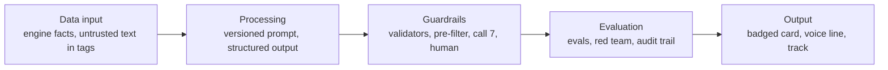

# Architecture (v1, after P03)

> **Kit v3 (19 Oct):** this page describes the v1 build, where the check is entered on the phone and only counts sync. In v3 the check arrives as photos through the bot or the PWA and the flows run on one back end; this page is rewritten in P05 and P14. See `docs/build/DECISIONS.md` (2026-10-19 · Kit v3 adopted) and `docs/build/reports/MIGRATION-v1-v3.md`.

What exists today. Later phases add the PWA, Practice Class, voice, Telegram and review screens; this page grows with them.

## AI in five layers

The ten calls (call 10, the demo teacher, runs in judge mode only), with the five layers written out for each, are in `ai/registry.py`. The README section "Where AI is used" and `GET /api/judge/ai-map` are generated from it.

## One path for every call

`ai/client.py::run_call(call_id, payload, context=...)`:

1. Load the versioned prompt (`ai/prompts/cNN_name.vN.md`, front matter id, version, model, changelog). The stable system block goes first with a cache marker.
2. Check the budget (live and record modes only).
3. Render the user message: trusted facts as JSON, untrusted text wrapped in tags.
4. Mode `recorded` reads `ai/fixtures/recorded/<call>/<hash>.json` (tests, CI, demos); `live` calls `client.messages.parse(..., output_format=Model)` with an explicit effort; `record` does live and saves the answer. With no `ANTHROPIC_API_KEY` the client refuses live and record.
5. Re-validate with Pydantic, run the call's validators, retry within bounds with the violations stated.
6. On failure, a deterministic fallback (template line, or "needs a human").
7. Write one audit row: call id, prompt version, model, tokens in/out/cache, cost from `ai/pricing.yaml`, latency, validator codes, checker verdict, retries, fallback.

Models and per-call policies (timeout, retries, effort, max tokens) are in `ai/config.py`; each model id can be overridden by its `MODEL_*` env var. Prices, with source URL and date, are in `ai/pricing.yaml`. API facts checked before coding are in `docs/build/DECISIONS.md` (P03 verified API facts).

## Layout

| Path | What |
| --- | --- |
| `ai/registry.py`, `ai/config.py`, `ai/schemas.py` | The 8 calls, their policies and output models |
| `ai/client.py`, `ai/audit.py`, `ai/pricing.py` | `run_call`, the audit sink, cost |
| `ai/calls/c07_checker.py` | Call 7, the output checker |
| `ai/validators/` | Code validators and the pre-filter (mypy strict) |
| `ai/guard/` | Gates, badges, explanations, rejections, teacher flags |
| `content/lang/`, `content/safety/`, `content/rejections/` | Word lists and reviewed rejection examples (data) |
| `services/api/judge.py` | Read-only judge endpoints |
| `evals/runners/redteam.py`, `evals/sets/redteam.yaml` | Red-team harness and seed set |

## Data stored by the AI layer

Tables `ai_calls`, `review_items`, `review_decisions`, `teacher_flags`, `consents` (`services/api/db.py`). None holds a child's data, a rehearsal transcript, a photo or teacher free text. See `docs/guardrails.md` for what the audit trail does and does not hold.

## Channels (v3, P05)

One back end, three thin adapters; the diagram and the table of files are in [channels.md](channels.md).
The flow engine owns state, consent, linking and deletion; adapters render steps and return answers,
and a test fails if one imports `engine/` or `ai/`.
