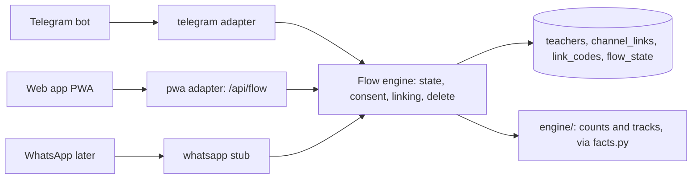

# Channels: one back end, thin adapters

Every teacher flow is defined once in `services/api/flows/` as steps (message, choice, link now;
photo batch, number grid, voice, media, text as their phases land). A channel adapter only renders
a step and returns the answer. It never computes a number, decides what comes next, or calls a model.

## What is where

| Piece | File | Job |
| --- | --- | --- |
| Steps | `services/api/flows/steps.py` | What a flow asks or says; copy by string key |
| Flows | `services/api/flows/onboarding.py`, `t1.py` | Language, consent, link code, home menu |
| Engine | `services/api/flows/engine.py` | Current step, answers, replay keys, linking, deletion |
| Words | `strings/{en,hi,ta}.json`, `services/api/strings.py` | The same copy for every channel |
| Rendering | `services/api/channels/base.py` | Step to text and buttons |
| Web | `services/api/channels/pwa/` | `GET /api/flow/current`, `POST /api/flow/answer`, `/code`, `/link` |
| Telegram | `services/api/channels/telegram/` | Update parsing, `/start`, `/start judge`, `/start CODE`, `/stop`, webhook |
| WhatsApp | `services/api/channels/whatsapp/` | Stub: numbered text options |

## Identity

A teacher has one random id (`t-` plus 16 hex). A device id (web) or chat id (Telegram) is linked to
it. To use the second channel she asks for an 8-character code (15 minutes, one use) and sends it to
the bot (`/start CODE`) or types it in the web app. Her other record on that channel is erased on
linking. `/stop` in Telegram, and "Delete my data" in either channel, ask once and then erase the
teacher, links, flow state, her consent history and her class counts everywhere.

## Adding a channel

1. Write `channels/<name>/` with a function that turns its incoming event into `(step_id, option_id)`
   and a sender that shows `Message` objects from `base.render_turn`.
2. Import nothing from `engine/` or `ai/` (`tests/channels/test_import_rule.py` fails otherwise).
3. Add the channel to `tests/channels/test_golden.py`: the same scripted answers must show the same
   words and choices and leave the same stored state as the web adapter.

## Known gaps

Photo, voice and number-grid steps have no adapter rendering yet (P08 and P10). The webhook sender
does not retry; a failed send is dropped. Telegram's Bot API cannot confirm a message was read.
