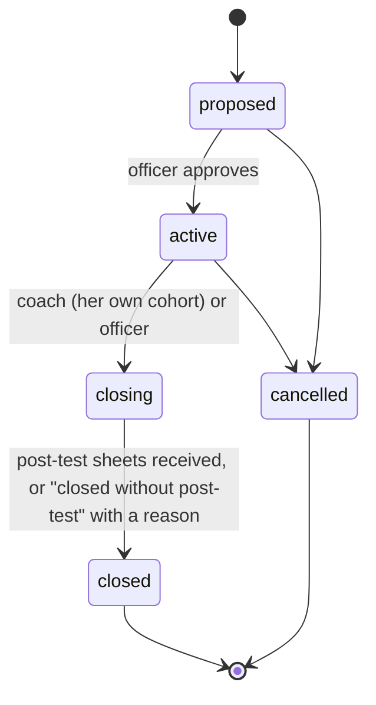
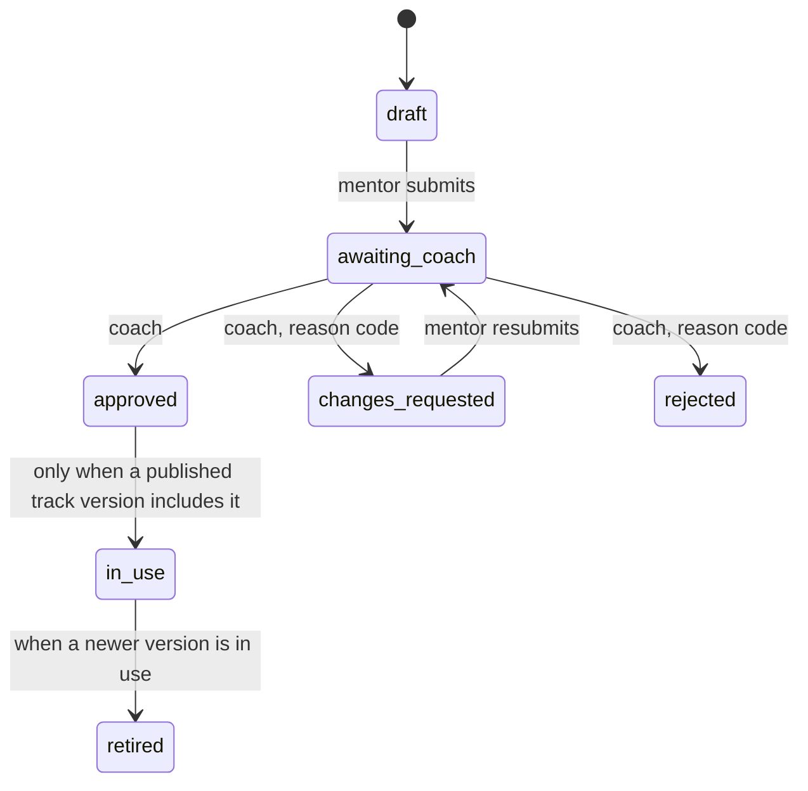

# Cohort space (P11, reduced scope)

A small, moderated, pseudonymous thread for the teachers of one cohort, with a lifecycle a coach runs and an approval step for what a mentor offers. Built in `services/api/cohorts/`; screens at `#/cohort` (teacher and coach). Tests: `tests/cohorts/`.

## Lifecycle

Every transition leaves an audit row (role, a pseudonymous id, the action; never post text). The thread is **open** only while the cohort is active and has at least 5 members; otherwise it is read-only and the prompts still show. Figures over fewer than 5 teachers (members, schools) are hidden.

## Mentor items

Editing an item in use makes a new draft version; the old one stays in use until the new one is approved. A coach decides only items in her own cohorts. **Nothing reaches a teacher unless approved.**

## Who sees what

| Person | Sees | Never sees |
| --- | --- | --- |
| Teacher | The visible posts of a cohort she joined, under labels like "Teacher 3" | Who is behind a label; held or hidden posts |
| Mentor | Her own cohorts: status and cohort-level figures; her own items; the thread she mentors | A member list, a teacher id, a school or class |
| Coach | Her assigned cohorts, the thread with held and reported posts, her cohort's mentor items | Cohorts she is not assigned to. **She can map a label to a teacher** (the coach and admin can; peers cannot) |
| Officer | All cohorts: status and figures under the same under-5 rule | Post text |

No handle, phone number or teacher id is in any response (a test checks every route).

## Posting checks (best effort, rule based, never sent to a model)

Every post is checked in code (`ai/validators/thread.py`): a first name from a list in three scripts, a roll-number phrase ("roll no 14", "no. 7"), a name with a relationship word ("Rahul's sister"), a phone number, an email or an ID-like number, and the pre-filter (harsh words, markup). A failed check stores nothing and asks her to rewrite. If the check cannot run, the post is held. **This is a filter, not a guarantee**: a teacher can still describe a child without a name. Compensating controls: a notice at the compose step in three languages, a 500-character cap, a Report button (a reported post is held and invisible to others until the coach decides) and a fast hide. If the coach marks a post as identifying a child, its text is erased at once. A teacher can delete her own posts.

## Retention (`thread.purge`, run by the officer route; schedule it daily in production)

| What | When the text goes |
| --- | --- |
| Reported, hidden or held post | 7 days after the decision (at once for an identifier) |
| Thread text of a closed cohort | 30 days after it closed |
| Any post | 90 days after it was written (stricter than "90 days after the last post") |
| A deleted post | at once |

Audit rows keep ids, rule codes and counts only.

## Not built (cut, see DECISIONS 2026-10-27 and PARKING)

The Telegram relay of the thread, voice replies and notifications, the mentor recording flow (M1), call 4 (method cards) and call 6 (the weekly digest), the mentor pages in the PWA (the routes exist: `/api/cohorts/mentor/*`), real role assignment (P12; until then a person is a pseudonymous id the judge deployment lets a request name). A mentor's name is never shown in the thread: a mentor posts as "Mentor".
