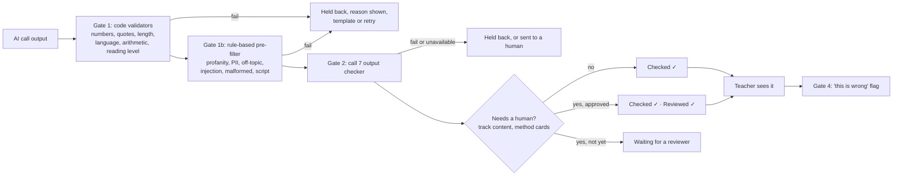

# Guardrails (v1, built in P03)

How wrong or unsafe AI output is stopped before it reaches a teacher. Everything here is code in `ai/validators/`, `ai/guard/` and `ai/client.py`; nothing depends on a prompt behaving.

## The gates

- Gate 2 only runs if gates 1 and 1b pass, so a line with a wrong number never costs a checker call.
- The checker **fails closed**: if call 7 times out, errors, or returns an inconsistent verdict (passed with failed items, failed with none, an unknown rubric item), the content is held and goes to a human or a template.
- A human cannot lift content past a failed automatic gate: the badge stays *none* (`ai/guard/badges.py`).
- Gate code: `ai/guard/gates.py`. Pipelines per content type: child line, feedback card, method card, track draft, digest.

## What each code validator checks

| Validator | Checks | File |
| --- | --- | --- |
| numbers | Digits in Latin, Devanagari and Tamil script must be in the allowed set (the engine's answer for a child line); number words in en, hi, ta are found so text can be forced to digits | `ai/validators/numbers.py` |
| quotes | A quote is a verbatim part of the transcript after case, spacing and punctuation are normalised; Indic vowel signs are kept | `quotes.py` |
| length | Words and characters (a child line is at most 30 words) | `length.py` |
| language | Script of each word against the language asked for, with a small allowance for code-mixing | `language.py` |
| pii | Phone numbers (incl. +91 and Devanagari digits), emails, 12-digit ID-like numbers, roster names; violations never repeat what they matched | `pii.py` |
| arithmetic | Every "a − b = c" and "a + b = c" statement; an intentional child mistake is tagged `[child-wrong]` | `arithmetic.py` |
| readability | Sentence length, long words, jargon list; stricter for child-facing lines | `readability.py` |
| prefilter | Profanity and harsh words (en, hi, ta, romanised), PII, off-topic and injection markers, malformed output, length, script | `prefilter.py` |

Word lists live in `content/lang/` and `content/safety/` (data, not code). The Hindi and Tamil lists are first drafts marked `TODO-HUMAN(Seema, Shivani, Gopi)` for native review.

## The output checker (call 7)

Rubric items: tone, child safety, stereotypes, language, fit to the target error, reading level for the stated audience, maths, no class statistics unless provided, and injection. For a simulated child line in the Practice Class, call 7 does not judge maths or fit: the engine chose the answer (often deliberately wrong) and code has already checked every number against it, so call 7 judges tone, safety, stereotypes, language, reading level, injection and role. The verdict is structured: `passed`, `failed_items`, a short reason for the team, and a one-line reason in the user's language. When unsure it fails the item.

## Rejection loop

Reviewers reject with one structured reason: wrong maths, culturally off, too complex for the medium, tone issue, or factually shaky (`ai/guard/rejections.py`). Approved examples are saved in `content/rejections/approved/` and the latest few go into call 7's prompt as "rejected before, and why". The examples text is part of the recorded-response key, so a new example never silently reuses an old recording.

## Reading level

Child-voice lines and child-facing lines in model lessons must sound like a Grade 3 child; teacher-facing lessons must be plain spoken language. Code proxies (sentence and word length, a jargon list) run at gate 1; call 7 has a rubric item on top.

## Injection defences

1. Teacher, mentor and reflection text is wrapped in tags (`<teacher_text>`, `<candidate_text>`, …) and every prompt says tagged text is data, never instructions. A closing tag inside the text cannot end its wrapper (`ai/client.py::_wrap`).
2. The pre-filter looks for instruction-like phrases in English, Hindi and Tamil before call 7.
3. Output is constrained by JSON schema and re-validated with Pydantic, so a hijacked reply cannot change shape.
4. Numbers in child lines must equal the engine's answer, whatever the text says.
5. The red-team harness (`evals/runners/redteam.py`, set `evals/sets/redteam.yaml`) runs 22 seed attacks (12 candidate AI outputs, 10 lines typed to the Practice Class) across six categories and three languages, plus Hinglish. Code-only results: `evals/results/redteam.json`; live results with call 7 and the call 2 labeller: `evals/results/redteam_live.json`. The numbers are in `docs/evidence/eval_summary.md`. That is the bar (0 unsafe reach a teacher) on the seed set only, not on the full set of 50 still to be written.

## Audit trail versus explanations

- **Audit trail** (`ai_calls`, `GET /api/judge/audit`): one row per AI call for the team and judges. Ids, hashes, token counts, cost, latency, validator codes, checker verdict, retries, fallback used, reviewer decision. It never holds prompt text, teacher text or model output.
- **Explanations** (`ai/guard/explain.py`): one line a user sees, built by code from facts already computed, in English, Hindi and Tamil. Teacher-facing lines use counts ("11 of 28 children"), never percentages. Example: "Held back: the checker found a maths error."

## Fallbacks and budget

Every call has a timeout, bounded retries (live turns retry once, stating what was wrong) and a deterministic fallback: a template line, or "needs a human". Non-judge traffic stops at `AI_BUDGET_USD_TOTAL` and `AI_BUDGET_USD_DAILY`; judge traffic stops at `AI_BUDGET_USD_HARD`.

## Call 10: demo teacher (judge mode only, built 22 Oct)

The AI that plays the teacher in the Practice Class "Watch" mode. It never reaches a real teacher, who hears the reviewed model run. Guardrails: the move id must be on the scenario's approved list; the line is 25 words or fewer; every number comes from the scenario's allowed set; no answer leak beyond what the style allows (the experienced style leaks nothing); on any failure the move's template line is used and the audit row records the fallback. The server refuses the call outside a judge session, every line is labelled "AI playing the teacher (demo only)", and recorded runs are labelled "recorded run". Eval 11 measures it. Spec: `docs/design/addendum-v3.1.md` §C.
