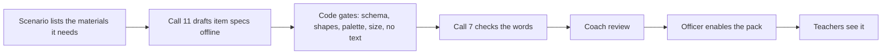

# Roadmap

What is built is in the README's status table and `docs/build/PROGRESS.md`. This page is what comes next and what it would take, in the order we would do it. Nothing here is built; nothing on it is claimed as working.

## Next, after the hackathon

| Step | What | Why it comes first |
| --- | --- | --- |
| 1. One-block pilot with a DIET, from January 2027 | Run the check, one track and the next check in one block, with a real coach and officer holding the roles (a BRC, CRC, DIET faculty member or head teacher). Pilot-scale verdict: extra fall over untrained errors plus an exact McNemar test | The simulated-practice idea is a hypothesis; only a real pilot tests it. We report the verdict whatever it is |
| 2. Then a district | The same, with cohorts of 15 to 20 teachers across blocks, mentors found from the previous term's results, the block-scale verdict (difference in differences with a bootstrap interval) | Needs at least 15 classes per arm for a verdict that can say "working" |
| 3. Finish what was cut | The call 9 reflection pointer, voice reflections, the mentor recording flow and call 4 method cards, the weekly digest (call 6), the cohort thread in Telegram, the model run (an audio demonstration of the move done well), Tamil lessons, the CRC visit brief, the officer's cohort approval screen and role assignment with consent | Each is specified in `docs/build/BUILD_PROMPTS.md` and logged in `docs/build/PARKING.md` |

## Channels and formats

- **WhatsApp** as a third adapter on the same back end (the flows are channel-neutral; `services/api/channels/whatsapp/` is a stub). Pilot teachers receive lessons on WhatsApp today by the coordinator sharing them by hand; the WhatsApp Business API is the automated version.
- **Lesson videos** as a templated slideshow synced to the same script and Sarvam audio. No video model.
- **IVR** for teachers without smartphones: the same lesson audio over a phone call.
- **Literacy tracks** for Hindi and Tamil letter and vowel-sign errors, using the same error-function, move-list and rubric anatomy.
- **A new-teacher induction track** on the same cohorts (AIC 74; NITI 147, 148 in `docs/design/evidence-digest.md`).

## Integration

- Item-level data from state assessments where it exists, so no separate check is needed.
- UDISE+ school identifiers for cohorts (as codes; no new personal data).
- Existing training records (for example NISHTHA and DIKSHA) so a track appears in a teacher's record. The time budget could export the minutes per teacher as a CPD-hours record (cut in P10).
- Operating costs: AI cost per teacher per track is in `docs/evidence/cost_per_teacher.md` (a range from measured per-call costs and stated assumptions); speech and hosting are separate.

## Topic packs: beyond Grade 3 maths

A pack is the data a new topic needs; the engine, the gates and the screens do not change.

| Part | What | Who owns it |
| --- | --- | --- |
| Error functions | Each error is a pure function from a problem to the set of wrong answers, with property tests | Engineers and the subject expert, together |
| Move list and rubric | The labelled teacher moves and what good teaching of one fix includes | The pedagogy lead (Seema) |
| Scenario values and personas | Problems, the seating mix, children's profiles | The pedagogy lead |
| Pictures | Items, mats, avatars and expressions are code-rendered SVG from JSON specs in `content/sprites/` (`docs/design/sprite-system.md`); a draft item from call 11 passes code gates, the output checker and a coach, and a pack reaches teachers only when an officer enables it | Authoring is offline; review is human |

Pictures are authored before use and reviewed by a person; nothing is generated or drawn at run time. No sample pack beyond the shipped `place-value-add-sub` pack and a data-only `fractions-demo` is claimed here, and the shipped pack's coach approval is still open (`docs/build/reports/SPRITES.md`).

## What we will not do

Record real classrooms or a child's voice, group teachers by age or experience, let a model state a number about a class, or show a teacher a percentage. These are rules, not roadmap items (`CLAUDE.md` section 4).
